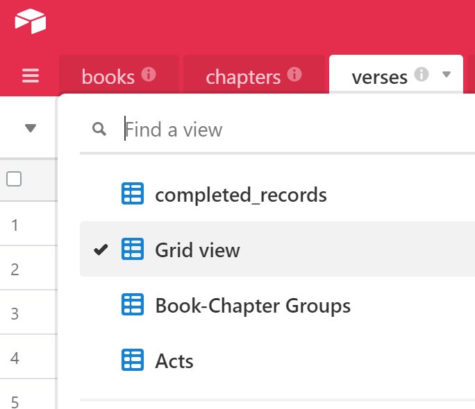
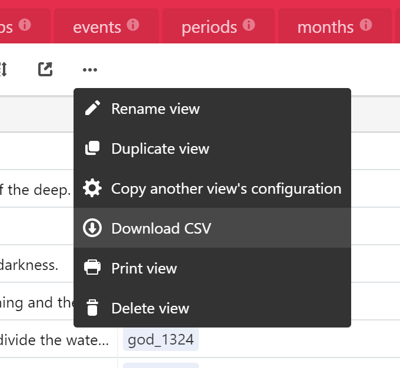
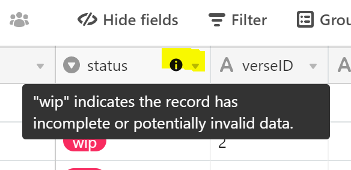

# View and Export Data with Airtable

Airtable is where Theographic's data is edited. It also offers a no-code, spreadsheet-like interface for searching, filtering, and inspecting the data. The instructions below explain how to choose a pre-defined view and download it as a CSV.

👉 [**Open the Theographic Bible Data base (read-only)**](https://airtable.com/shrlkhIzIUzmx9whR)

> The CSV and JSON files on GitHub are periodic exports of this base. If you only need the full dataset, download it from the [`json/`](../json) or [`CSV/`](../CSV) folders instead. Field definitions are in the [JSON Fields Documentation](json-fields-documentation.md).

---

## Intro to Airtable

Get a brief tour of Airtable [here](https://www.airtable.com/platform), or watch the in-depth tutorial below.

[https://vimeo.com/263305987](https://vimeo.com/263305987)

## Choosing pre-defined views

On some tabs, there are pre-defined views that let you choose a subset of the data to view or download. These views will identify records which are fully validated (completed_records) or provide quick access to grouped and pre-filtered sets. Click the drop-down at the top-left to change views.

## Downloading as a CSV file

Data sets are separated by tabs which can be downloaded separately. From each tab, choose the `...` menu and click **Download CSV**.

## Field-specific comments

Column headers with an "i" symbol contain explanatory details. Hover on this icon to view comments.

